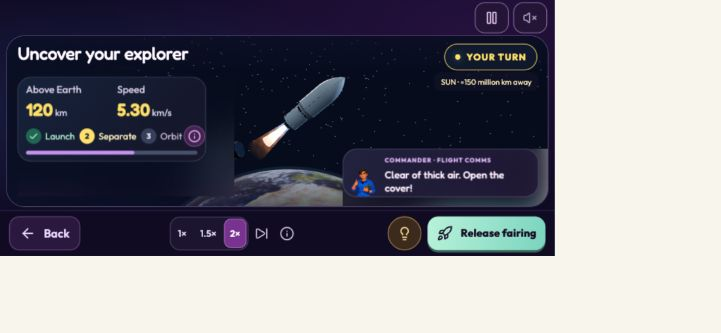

# Mobile game mode

## Restore point

The unchanged version before this work is saved locally and on GitHub as
`backup/before-mobile-game-mode-2026-10-10`, at commit
`8497c5b3fff00c16983f694fcbe90688654258df`.

New mobile changes are in the working tree. To inspect the backup without
overwriting those changes, open its branch on GitHub or use a separate Git
worktree. Do not reset the current checkout unless its newer changes have been saved.

## Behavior

- On a phone, Play now and Judge demo request fullscreen from the user click,
  then try landscape orientation locking where supported.
- If rotation cannot be locked, a rotate-phone guide appears. Play upright is
  always available; browser API failures do not prevent playing.
- The in-game website navbar is replaced by compact Pause and Voice controls.
  Words, Settings, Fullscreen, Turn phone and Mission home are in Pause.
- Next and Hint stay in the bottom action dock. Landscape layouts use a compact
  paged parts tray alongside the 3D workshop, with shorter controls and dialogue.
- Opening Pause or rotation guidance pauses a running rover rehearsal or flight.
  Back to game restores the previously running activity. Help drawers leave it
  paused until the player resumes. Returning home releases fullscreen/orientation
  owned by this game and restores the normal website navbar.
- Safe-area padding leaves room for phone cutouts and the bottom home indicator.

## Adjust the implementation

- `src/game/story/mobileGame.css`: mobile sizes, layout, action dock and dialogs.
- `src/game/story/mobileGameContext.ts`: device/viewport detection.
- `src/game/story/MobileGame.tsx`: fullscreen, rotation guide and Pause menu.
- `src/game/story/ExactStory.tsx`: integration with flight/rover pause and resume.
- `src/game/story/SelectionScreens.tsx`: Play entry points and mobile name input.
- `src/game/story/StoryShell.tsx`: desktop versus mobile navigation.
- `index.html`: safe-area viewport metadata and browser theme color.

## Manual review

Reviewed the game in the browser using phone landscape sizes (844 × 390 and
667 × 375), phone portrait (390 × 844), and desktop (1280 × 800). Browser host
scaling changes the resulting CSS viewport; inspected actual DOM bounds as well.

Verified name/story flow, mission selections, manual part drag, animated auto
build, radar/mass check, drive/drill/return rehearsal, budget, three packing
actions, approval, launch countdown, booster separation, 2× speed, skip, result
and home. The reviewed landscape workshop and flight screens had no document
overflow. Pause stopped active rehearsal/flight and Back to game resumed them.
Words and Settings remain reachable. Portrait fallback and desktop navbar were
checked. No automated test suite was run, per the user's preference.

Fullscreen succeeded in the review browser. Physical Android/iPhone testing has
not been performed; fullscreen and automatic orientation locking depend on the
browser. The explicit rotate guide and upright fallback cover unsupported APIs.

