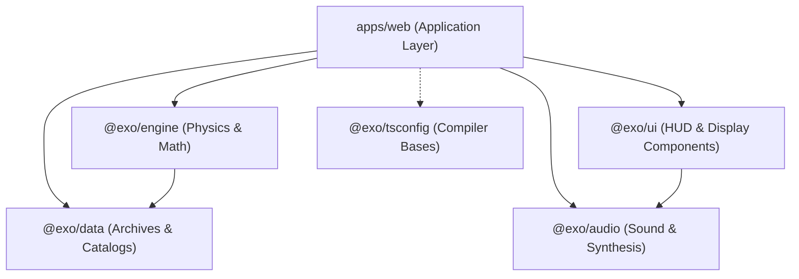

# Monorepo Architecture & Feature Modularization Blueprint

This document defines the comprehensive codebase architecture, domain-driven package boundaries, and directory layout for **Zero To Beyond**. It serves as the primary technical specification for expanding and maintaining the repository with maximum human readability and engineering convenience.

---

## 1. Monorepo Overview & Workspace Topology

The repository is structured as a multi-package Turborepo workspace managed by **pnpm workspaces** (`pnpm-workspace.yaml`).

```
exovisionaries2026/
├── apps/
│   └── web/                         # Primary Vite + React 19 spaceflight application
├── packages/
│   ├── engine/                      # Pure NASA physics calculations, orbital models & mission validation
│   ├── data/                        # NASA mission archives, parts database, launch slots & manifests
│   ├── audio/                       # Web Audio synthesizer, sound cues & audio store
│   ├── ui/                          # Aerospace HUD primitives, OrientationGuard, LoadingScreen & visual components
│   └── tsconfig/                    # Centralized TypeScript compiler configurations
├── docs/                            # Architectural documentation, blueprints & technical specifications
├── temp/                            # Scratch notes, pull request descriptions & commit message drafts
├── turbo.json                       # Turborepo task pipeline & caching configuration
└── pnpm-workspace.yaml              # Workspace definitions
```

---

## 2. Package Boundaries & Core Package Segregation

Generic computational logic, datasets, audio synthesizers, and design system primitives reside strictly in independent workspace packages, ensuring `apps/web` functions purely as an application integration and orchestration layer.



### `@exo/engine` (`packages/engine`)
- **Role**: Pure mathematical modeling, orbital mechanics, rocket mass and power budget accounting, and asset preloader task management.
- **Submodules**:
  - `physics/`: Multi-stage delta-v calculations, ascent velocity curves, atmospheric drag models, and payload capacity equations.
  - `loadingEngine.ts`: Task promise accumulator and procedural loading screen scheduler.
- **Constraints**: 100% platform-independent; zero DOM dependencies.

### `@exo/data` (`packages/data`)
- **Role**: Structured aerospace hardware datasets, NASA historical flight records, astronaut dossiers, and mission manifests.
- **Submodules**:
  - `archive/`: Chronologically partitioned NASA records (`earlyDecades.ts`, `apolloEra.ts`, `shuttleEra.ts`, `modernEra.ts`, `artemisEra.ts`, `events.ts`, `timelineUtils.ts`).
  - `parts/`: Authentic rocket stages, rover chassis, solar panels, and scientific instruments (`launchVehicles.ts`, `spacecraft.ts`, `payloads.ts`, `upgrades.ts`, `slots.ts`).
  - `missions/`: Lunar landing sites (crater rim, permanent shadow), science objectives, candidate astronaut biographies, and verified citation sources.
- **Constraints**: Pure data definitions and immutable reference arrays.

### `@exo/audio` (`packages/audio`)
- **Role**: Procedural Web Audio API sound synthesis and synchronized state controls.
- **Modules**:
  - `soundEngine.ts`: Unified audio controller facade exposing tactile sound effects.
  - `synthEffects.ts`: Algorithmic generators (sine sweeps, resonant low-pass white noise, arpeggio chimes, tactile clicks) with zero external audio file dependencies.
  - `audioStore.ts`: Global reactive volume, sound effects toggle, and speech narration enablement store.
- **Constraints**: Immediate suspension compliance on mobile orientation blocks.

### `@exo/ui` (`packages/ui`)
- **Role**: Reusable aerospace HUD primitives, orientation enforcement, loading sequences, and vector hardware symbology.
- **Components**:
  - `OrientationGuard`: Mandatory horizontal viewport guard and universal state freeze orchestrator.
  - `LoadingScreen`: Procedural asset preloading screen with educational carousel cards and progress interpolation.
  - `CosmicBackground`: Performant Three.js canvas starfield simulation with orientation pause compliance.
  - `ProgressRing`: SVG-based radial progress indicator.
  - `GameInfo`: Accessible multimodal information and reference drawer.
  - `SceneFallback` & `SceneBoundary`: WebGL context recovery and Three.js error boundary.
  - `InstallAppModal`: Cross-platform PWA installation instructions (`install-modal/`).
  - `CartoonIcons` & `RealisticPartIcons`: Vector spacecraft and scientific instrument symbology (`icons/parts/`).

### `@exo/tsconfig` (`packages/tsconfig`)
- **Role**: Shared compiler configurations ensuring consistent TypeScript behavior across the workspace:
  - `base.json`: Modern ESNext compiler options with strict type checking.
  - `react-library.json`: Library preset with JSX transform for shared UI packages.
  - `node-library.json`: Pure headless library preset for `@exo/engine` and `@exo/data`.

---

## 3. Web Application Directory Taxonomy (`apps/web/src/`)

To guarantee maximum human readability and maintainability as new features are added, application code is organized into clear domain slices:

```
apps/web/src/
├── features/                        # Domain-driven mission slices
│   ├── narrative/                   # Mission briefings, character dialogue & speech
│   ├── workshop/                    # Spacecraft & rover assembly bay, 3D workshop
│   ├── crew/                        # Astronaut candidate selection & 3D crew viewer
│   ├── readiness/                   # Systems telemetry checks, packing & radar repair
│   ├── flight/                      # Launch countdown, staging & orbital insertion
│   ├── landing/                     # Trans-lunar injection, descent & touchdown
│   ├── surface/                     # Lunar EVA fieldwork & rover navigation
│   ├── science/                     # Subsurface ice drilling & sample spectrometry
│   ├── hazards/                     # Surface hazard mitigation & sensor recovery
│   ├── return/                      # Ascent staging, Earth re-entry & debrief
│   └── archive/                     # NASA historical timeline & flight manifests
├── shared/                          # Cross-cutting application infrastructure
│   ├── shell/                       # StoryShell, GestureGuide, MobileGame, GameSettings
│   ├── styles/                      # Central tokens (index.css, typography.css, App.css)
│   ├── services/                    # Dynamic preloader & NASA open-data services
│   └── debug/                       # Development toolbar, catalog & session seeders
├── App.tsx                          # Root application routing & view resolution
└── main.tsx                         # DOM hydration & React 19 root mount
```

### Feature Slice Layout
Each feature slice in `apps/web/src/features/<feature>/` adheres to an autonomous internal structure:
- `components/`: UI cards, interactive dialogs, and visual control HUDs.
- `viewports/`: Three.js canvas scenes and 3D mesh rendering mounts.
- `state/`: Specialized Zustand stores or action reducers scoped to the feature.
- `types.ts`: TypeScript contracts and telemetry models specific to the feature.
- `index.ts`: Public barrel export exposing only sanctioned components and hooks to the rest of the application.

---

## 4. File Size Ceiling & Directory Density Governance

To eliminate spaghetti code and keep every source file instantly understandable:

1. **Strict 250-Line Guard**: No TypeScript or TSX file may exceed 250 lines of code. When a file approaches this limit:
   - Extract UI sub-renders into separate components (e.g., `InstallAppModal.tsx` -> `DesktopInstructions.tsx`, `AndroidInstructions.tsx`).
   - Extract stateful event listeners and logic into custom hooks (e.g., `ExactStory.tsx` -> `useStoryPersistence.ts`, `useStoryPauseResume.ts`).
   - Extract calculation helpers and data mappings into dedicated pure modules (e.g., `debugConfig.ts` -> `debugCatalog.ts`, `debugSessionSeeder.ts`).
2. **Directory Density Ceiling**: Directories must not exceed 12 files. When more files accumulate:
   - Group cohesive files into domain subdirectories.
   - Provide an `index.ts` barrel export at the directory root.
3. **CSS Stylesheet Integrity**: CSS stylesheets are exempt from arbitrary line-splitting. Stylesheets must remain intact and formatted cleanly with consistent indentation.
4. **Backwards-Compatible Facades**: Relocated or refactored files must maintain legacy re-export bridges at their original paths to guarantee zero import drift.

---

## 5. Static Asset Pipeline & Public Hierarchy

Static media in `apps/web/public/` is categorized into domain hierarchies:

```
apps/web/public/
├── story/
│   ├── audio/                       # 737 voice narration & SFX tracks
│   │   ├── checks/                  # Flight readiness & telemetry check audio
│   │   ├── crew/                    # Astronaut selection & dossier narration
│   │   ├── dialogue/                # Story dialogue & commander briefings
│   │   ├── engineer/                # Chief engineer feedback & reactions
│   │   ├── flight/                  # Ascent staging & liftoff countdowns
│   │   ├── glossary/                # Aerospace terminology definitions
│   │   ├── incidents/               # Emergency drills & hazard alerts
│   │   ├── journey/                 # Trans-lunar flight & coast narration
│   │   ├── landing/                 # Lunar powered descent & touchdown
│   │   ├── repair/                  # Radar repair & equipment swap guidance
│   │   ├── return/                  # Ascent staging & splashdown debrief
│   │   ├── rocket/                  # Rocket hangar assembly instructions
│   │   ├── rover/                   # Lunar rover driving & sample collection
│   │   ├── science/                 # Subsurface drill & spectrometer audio
│   │   ├── surface/                 # Lander ramp deployment & EVA exploration
│   │   └── male/                    # Alternate male voice audio (subdivided identically)
│   ├── characters-v1/               # Multi-part 2D sprite puppet atlases & rigs
│   └── slides/                      # Mission loading screen carousel illustrations
├── textures/                        # PBR materials & planetary surface textures
└── models/                          # Optimized glTF/GLB 3D aerospace meshes
```

### Asset Performance Standards
- **Modern Formats**: WebP for all photographic, character, and celestial illustrations; compressed MP3/OGG for audio narration.
- **Type-Safe Registry**: Every static asset URL must be registered in a type-safe catalog (`assetRegistry.ts` or `voiceClips.ts`), accompanied by automated build-time existence checks.

---

## 6. Preloading, Orientation & State Freeze Protocols

1. **Heavy Workload Shielding**: All Three.js geometry generation, texture uploads, audio synthesis buffers, and network requests must execute behind `LoadingScreen`. Preload promises register via `useLoadingStore.getState().registerLoaderTask(taskPromise)`.
2. **Universal State Freeze**: When `OrientationGuard` blocks portrait viewports or a loading sequence is active:
   - Flight ascent timers, physics steps, and rover telemetry halt immediately at the current frame.
   - Web Audio suspends via `SoundEngine.pauseAll()`.
   - CSS animations pause via `.orientation-guard-wrapper.is-blocked * { animation-play-state: paused !important; }`.
   - Asset loading promises continue resolving unhindered in the background.

---

## 7. Verification & Build Pipeline

Every architectural modification must be verified using the automated quality pipeline:

```bash
# 1. Lint all workspace packages with oxlint
pnpm run lint

# 2. Strict TypeScript type check without emitting files
pnpm --filter @exo/web exec tsc --noEmit
pnpm --filter @exo/ui exec tsc --noEmit

# 3. Full Turborepo production build & Vite bundle compilation
pnpm run build
```

- **Cloudflare Pages Deployment**: Handled automatically via `.github/workflows/deploy.yml` upon pushing to `main`, publishing the optimized `apps/web/dist` bundle.
