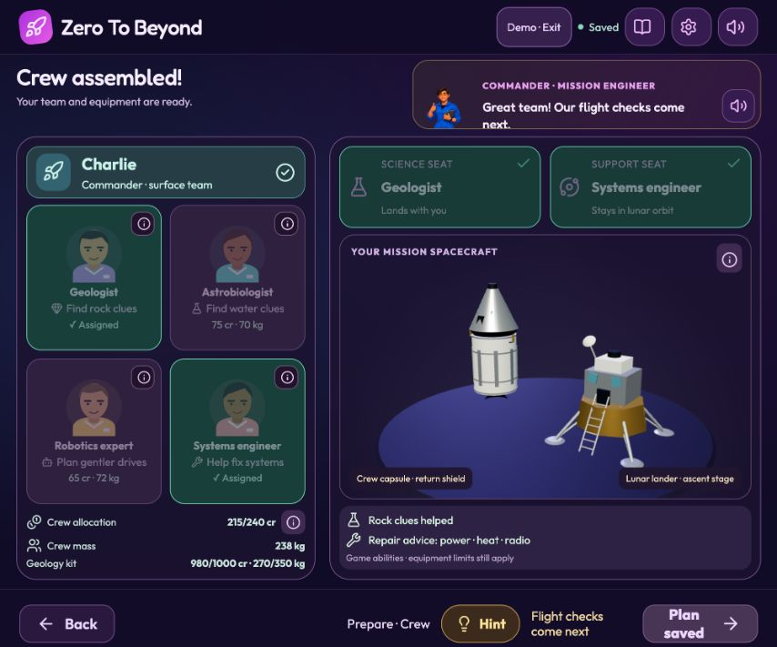

# Module 2 — Objective-specific preparation and crew

Delivered 2026-10-12 on `feat/full-moon-foundation`.
Module 1 checkpoint: `ff9c380`, also preserved at `backup/module1-complete-20261012`.

## Playable flow

Objective and site → five equipment stages → short crew briefing → role matching → saved preparation plan.
Ice retains NSS, NIRVSS, TRIDENT and optional MSolo. Geology has seven tool families: camera, infrared rock scanner, element scanner, crystal lab, sample tools, layer radar and Moonquake sensor. Each main instrument has three scripted numeric tiers. A camera, a sample collector and at least one analytical instrument are required. Players can equip additional instruments if they fit the same overall equipment allocation.

The main inventory is authoritative for both objectives: no invisible parallel geology kit. Installing a family upgrade replaces the older tier. Mass, credits, operating power, scientific detail capability and assembly geometry all derive from that inventory. Undo and redo restore the selected tier and depth. Selecting a scoop replaces the drill and removes deep-drilling controls.

Science equipment has a 100-kg sub-limit inside the overall 350-kg allowance; it is not another free budget. Crew has a separate 240-credit roster allocation. Commander plus one scientist land; a systems/robotics expert stays with the command spacecraft in lunar orbit. Wrong-role matches do not advance. Drag-and-drop, tap-to-select, keyboard buttons, cancellation and animated Hint demonstrations are available. Candidate details are optional ⓘ panels.

## Effects and scope

Robotics assistance applies a bounded authored 10% reduction to rover driving load in the shared rehearsal preview. It does not increase battery capacity or reduce drill peak load. Switching to Systems Engineer restores unassisted driving arithmetic and selects power/thermal/radio advice. Science specialists select mineral or volatile interpretation assistance. Actual incident repairs and scientific interpretation gameplay will use these contracts in later modules; they are not yet playable surface operations.

Basic/balanced/advanced sample drills reach 30/60/100 cm in this game. These depth ceilings, detail levels, the scoop's 3 kg / 20 credits / 5 W and crew abilities are explicitly authored estimates. Catalogue tier numbers are script allocations, not certified NASA specifications or procurement prices. Instrument function and supplied Apollo-style architecture remain separate from numeric game balancing.

Crew spacecraft preview shows a command/service spacecraft with a return heat shield plus a separate lunar lander with descent and ascent hardware. It is an illustrative architectural preview, not a flight-certified replica. Gross spacecraft mass, propellant, life-support duration, crewed readiness, flight and return are still pending.

**The normal flow intentionally ends at the preparation plan until Module 3 adds human readiness.** Old robotic launch screens remain in source but cannot authorize the new crewed mission. No workshop purchase, auto-build or crew assignment earns actual science points.

Auto-build animates the actual install/Next events through an objective-specific kit and stops at the crew briefing. Judge demo can choose Ice or Geology and begins with a prepared kit at role matching; it never overwrites the normal save. Older v1/v2 save keys remain untouched; v3 stores the canonical inventory and validated crew roles. Changes clear obsolete readiness and flight state.

## Manual verification

No automated gameplay test programs were run, per the user's instruction. Browser interactions exercised:

- Ice demo: 960 credits, 280 kg; its crew selection does not auto-fill roles.
- Geology demo: 865 credits, 255 kg, 16 parts, 30-kg science kit.
- Basic → Balanced camera: still 16 parts; 885 credits, 257 kg; peak load 203 → 210 W.
- Replacing a drill with a scoop: depth controls disappear; credits and mass fall; Undo restores the drill.
- Basic drill depth caps at 30 cm; changing 20 → 30 cm increases the upgraded kit's drilling energy from 3.5 → 5.3 Wh.
- Wrong-role match is rejected; valid Geologist + Robotics assignment shows 215/240 credits and a 2.5-Wh drive rehearsal saving.
- Held drag assigns an Astrobiologist to the surface science seat; tap matching is also checked.
- Crew save, Back, crew briefing, equipment editing and return to crew preserve coherent selections.
- Desktop and short phone landscape retain the primary buttons, seat targets and drill slider. Compact science families use a native dropdown on short screens.
- Ice and Geology animated auto-builds both finish at the crew briefing.
- Advanced Geology drill raises the kit to 1,025 credits; Fix focuses the optional element scanner. Removing it resolves the excess (980 credits) while retaining the required rock-analysis tool. Retest returns through crew selection rather than bypassing human readiness.
- Exiting the demo restores Asif's existing saved adventure.

New crew dialogue/advice uses the existing Guy Chief, Sonia female companion and Andrew male companion recorded voices, preserving the configured 1.5× playback. Heavy crew 3D rendering is lazy loaded, pauses when hidden and disposes GPU resources. Build/typecheck and focused lint are recorded below after final verification.

## Final code checks

`npm run build` passed, including TypeScript. Focused oxlint for the changed preparation, crew, navigation and reducer modules passed without warnings. Full-repository lint completed with existing warnings in older screens/backups; Vite still reports its existing large Three.js chunk and URL-resolution notices. Automated gameplay test scripts were not run.

